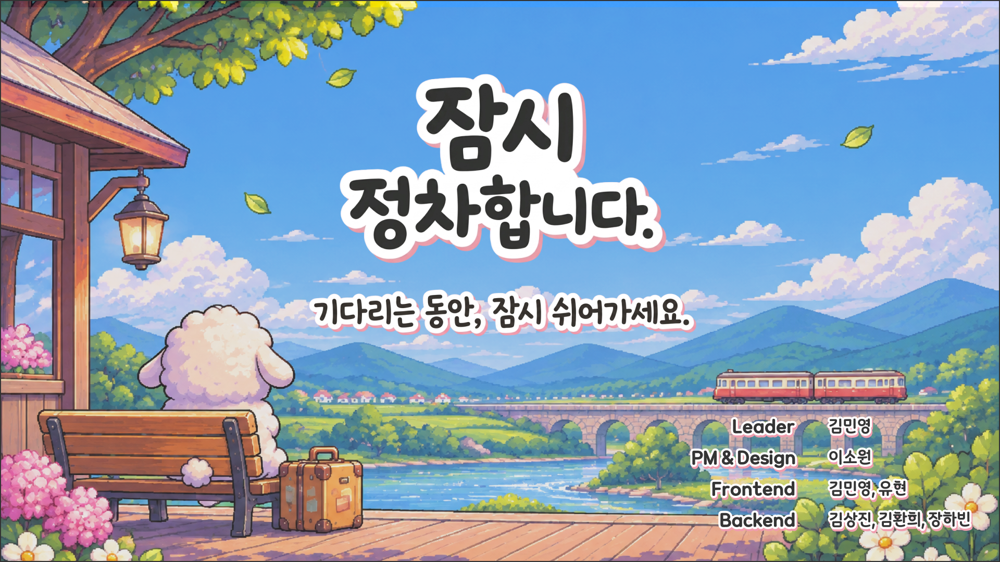

<p align="center">
  
</p>

<h3 align="center">기다리는 시간을 담요 조각으로 남기는, 함께 기다리는 대기실</h3>

<p align="center">14기 멋사대학 간지톤 : 아리톤 &nbsp;·&nbsp; 6팀 출품작</p>

<p align="center">
  
  
  
  
  
  
  
</p>

<p align="center">
  <a href="https://jamsi-stop.vercel.app/">서비스 열기</a> &nbsp;|&nbsp; <a href="AGENTS.md">작업 규칙</a>
</p>

## 서비스 소개

**잠시 정차합니다**는 기다림의 순간을 혼자 흘려보내지 않도록 돕는 서비스입니다.
대합실 승차권을 받아 대기실에 입장하면 다른 사람들과 같은 공간에서 함께 기다릴 수 있고, 기다림을 마칠 때 그 순간을 담요 조각으로 남깁니다.
모인 조각은 내 양의 담요가 되어 계정에 저장됩니다.

## 화면

| 경로 | 화면 | 설명 |
|---|---|---|
| `/` | 온보딩 | 닉네임·PIN 입력 후 승차권을 받습니다 |
| `/waiting-room` | 대기실 | 다른 사람들과 함께 기다리는 2D 공간 (Phaser는 여기에만 붙습니다) |
| `/my-sheep` | 마이 양 | 내 양, 담요, 임시 조각함 확인 |
| `/my-sheep/piece/:pieceId` | 조각 상세 | 기다림의 한 순간을 담은 조각 (탭하면 뒤집힘) |
| `/finish-waiting` | 기다림 마치기 | 기다림을 끝내고 조각을 받음 |
| `/finish-waiting/save` | 담요 조각 저장 | 로그인해서 조각을 계정의 담요에 저장 |

## 시작하기

Node.js와 npm이 필요합니다.

```bash
npm install
npm run dev
```

## 스크립트

| 명령 | 하는 일 |
|---|---|
| `npm run dev` | 개발 서버 |
| `npm run build` | `dist/`에 프로덕션 빌드 |
| `npm run lint` | ESLint 검사 |

## 기술 스택

| 구분 | 사용 기술 |
|---|---|
| UI | React 19 |
| 2D 대기실 | Phaser 4 |
| 라우팅 | React Router 7 |
| 빌드 | Vite 6 |
| 린트 | ESLint 9 |
| 언어 | JavaScript (ES Modules) |
| 실시간 통신 | WebSocket + STOMP (직접 구현) |
| 배포 | Vercel |

## 환경 변수

`.env.example`을 복사해 `.env`를 만듭니다. 클라이언트에는 `VITE_` 접두사 변수만 노출되므로 비밀키는 넣지 않습니다.

## 프로젝트 구조와 컨벤션

```text
src/
├─ main.jsx, App.jsx    # 진입점, 라우팅
├─ PhaserGame.jsx       # React ↔ Phaser 연결
├─ pages/               # 라우트 단위 페이지
├─ components/          # React UI (common/, onboarding/, waitingRoom/)
├─ services/            # API · WebSocket 호출
├─ data/                # 정적 데이터
└─ game/                # Phaser 씬, 오브젝트, EventBus
public/                 # 정적 파일, assets/, 화면별 CSS
vite/                   # Vite 설정 (dev / prod)
```

- React는 UI, Phaser는 대기실 캔버스를 맡고, 둘은 `src/game/EventBus.js`로만 통신합니다.
- 브랜치: `feat/{ISSUE_NUMBER}`, 푸시·병합 대상은 `develop`
- 커밋: `{ISSUE_NUMBER} {Type}: 한국어 설명` (예: `59 fix: ...`)
- 코드는 영어, UI 라벨과 주석은 한국어
- PR 전 `npm run lint`, `npm run build` 통과 필수

자세한 규칙은 [AGENTS.md](AGENTS.md)를 참고하세요.

## 웹 배포

Vercel로 배포하며, [jamsi-stop.vercel.app](https://jamsi-stop.vercel.app/)에서 열 수 있습니다.
`vercel.json`의 rewrite 설정으로 주소를 직접 입력하거나 새로고침해도 같은 화면이 열립니다.

## 팀

| 역할 | 이름 |
|---|---|
| Leader | 김민영 |
| PM & Design | 이소원 |
| Frontend | 김민영, 유현 |
| Backend | 김상진, 김환희, 장하빈 |
